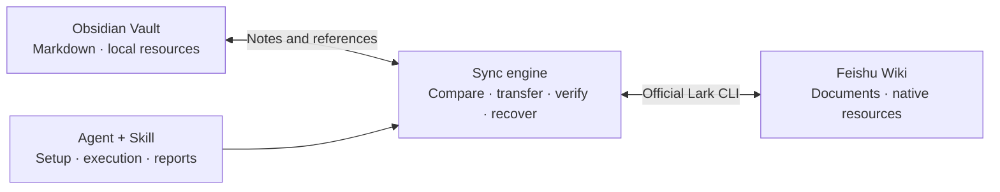

<div align="center">

<h1>Obsidian ↔ Feishu Bridge</h1>

**Edit from either endpoint. Keep notes and references in sync.**

[简体中文](README.md) · [English](README.en.md) · [Agent skill](skills/obsidian-feishu-sync/SKILL.md) ·
[Architecture](docs/architecture.md) · [Contributing](CONTRIBUTING.md)

**0.1.0 alpha** · Python 3.11+ · [MIT](LICENSE)

</div>

Connect an Obsidian Vault and a Feishu Wiki subtree into a knowledge collection
that can be updated from either endpoint. Note bodies, images and internal
references synchronize through registered identities. PDFs, native Sheets,
Base and whiteboards retain cloud objects with local access entries.

The bridge handles four layers: official access, resource and link conversion,
document-tree mapping, and independent edits at both endpoints. It keeps each
representation's verified baseline, generates local patches, reads back written
structure, downloads new images for byte verification, and isolates conflicts
to the affected note.

A Skill guides login and scope selection. Code then performs comparisons,
transfers and recovery, with state saved in a local profile for the next agent
or conversation. **The engine makes zero model API calls.** Agent setup and
exception interpretation use the chosen model separately.

**70 synthetic tests and eight real Feishu API scenarios using synthetic data**
include ordered batch
writes for a 130-paragraph note, image-byte-only updates, pairing of mutually
linked new notes, and independent synchronization alongside an isolated
conflict. Repeat-run acceptance checks reached zero additional writes. See
[validation](docs/validation.md) for environments and the scope of each run.

## Contents

- [Why a bridge?](#why-a-bridge)
- [Quick start with an agent](#quick-start-with-an-agent)
- [Install](#install)
- [First use](#first-use)
- [Daily use and Agent skill](#daily-use-and-agent-skill)
- [Capabilities and limits](#capabilities-and-limits)
- [State, cost and recovery](#state-cost-and-recovery)
- [Updates](#updates)
- [Development and validation](#development-and-validation)

## Why a bridge?

### 1. Connect the gap between the official tools

[Obsidian Sync](https://help.obsidian.md/sync) synchronizes Vaults across devices.
The [official Lark CLI](https://github.com/larksuite/cli) provides access to Feishu
documents, Wiki nodes and resources. Keeping a Vault paired with a Wiki subtree
also requires cross-system identities, content comparison, topology mapping
and conflict recovery. This project implements that engine above the official
CLI so an agent can perform initial adoption and subsequent updates.

### 2. Translate resources and links while controlling transfer volume

Obsidian references local image and PDF files through filesystem paths. Feishu
uses document blocks, resource tokens and cloud URLs, alongside native Sheets,
Base and whiteboards. Repeated transfers of large PDFs consume bandwidth and
waiting time. Fully reading and rebuilding Base records, views and whiteboard
nodes also adds API calls and conversion steps. Filenames and copied URLs alone
cannot retain these relations.

The bridge embeds images and verifies their bytes, keeps access links for cloud
PDFs, and retains native tables and whiteboards. Referenced local files are
hosted by content hash within their target scope, so identical scoped content
can be reused. Changed files receive new hosted versions while earlier versions
remain available. Identity mappings translate note and resource references into
local paths or cloud addresses. New notes receive Wiki node identities before
their bodies are written, allowing mutually linked notes to be paired within
the same synchronization run.

Body updates are separated from large-resource transfers. Routine checks batch
metadata for paired documents before reading candidate bodies. Text changes use
local patches, unchanged resources retain their references, and comparisons
run in code without a model reading each note.

### 3. Plan paths for a document tree and a filesystem

An Obsidian folder contains Markdown and attachment files. A Feishu Wiki node
can carry its own document body and child documents, with files embedded inside
the body. A parent document therefore needs both a content location and a
container for its descendants.

The bridge maps a parent `Topic` document into `Topic/_index.md` and sibling child
notes. New local directories correspond to Wiki container nodes. Identities
remain separate from display names, duplicate or Windows-invalid names receive
stable suffixes, and cross-endpoint references use the registered mappings.

### 4. Compare independent baselines when both copies changed

On first adoption, both endpoints can contain recently edited documents without
a shared synchronization history. After pairing, the same note can be edited
independently at either end. A newer timestamp cannot establish whether one
copy contains the other endpoint's changes.

Initial adoption pairs only unique equivalent content and isolates differing
same-path drafts. Subsequent runs keep separate verified baselines for Markdown
and cloud blocks: single-side changes synchronize, equivalent double edits align
baselines, and differing double edits preserve both versions and pause that note.
Write journals, source snapshots and unexpected intermediate versions provide
evidence for verification and recovery after interruption.

### Run the workflow through a Skill and code

The Skill gathers scope, guides official CLI authorization, invokes commands and
explains review items. Code maintains identities, references, change state and
recovery records. An agent receives counts and paused items, a new conversation
resumes from the profile, and a `watch` process handles continuous polling.



## Quick start with an agent

Give your agent the downloaded repository and send:

```text
Read skills/obsidian-feishu-sync/SKILL.md in this repository.
Install the synchronization engine and Skill, and help me connect
an Obsidian Vault with a Feishu Wiki subtree.
Guide official CLI login, ask for the Vault, Wiki scope and initial-content mode,
show the adoption plan, then synchronize supported changes and report paused items.
```

Provide your own Vault directory and Wiki URL, and complete browser authorization.
**Install both the Skill and engine:** the Skill guides the agent, while `ofb`
performs comparisons and transfers. Copying `SKILL.md` alone does not install the program.

For an existing profile:

> Use obsidian-feishu-sync to synchronize the notes profile. Report paused items.

## Install

Requires Python 3.11+ and the official Lark CLI. The CLI installer shown below
also needs Node.js/npm; skip that command if the CLI is already installed.
Start in a checkout or extracted source release of this repository:

```sh
python -m venv .venv
# Activate .venv using your platform's usual command, then:
python -m pip install .
npx @larksuite/cli@latest install
ofb install-skill
```

On POSIX, activation is `source .venv/bin/activate`; on Windows PowerShell it is
`.venv\Scripts\Activate.ps1`. A built wheel can also be installed with
`python -m pip install /path/to/obsidian_feishu_bridge-VERSION-py3-none-any.whl`.
The wheel includes the engine and Skill. The official CLI retains authentication
in its own credential store.

## First use

```sh
# New CLI application: guided browser setup and login.
ofb auth --setup
# If the application is already configured, use `ofb auth` instead.

ofb --profile notes init --vault /path/to/vault --wiki HTTPS_WIKI_URL --mode both
ofb --profile notes plan
ofb --profile notes bootstrap --approve
ofb --profile notes sync --approve
```

`init` without arguments prompts for the Vault directory, target Wiki URL and
initial-content mode. The Vault directory must exist; it may be empty.
Use `--cli /path/to/lark-cli` on `init`/`auth` if the CLI is not on PATH.

Choose the initial mode:

| Mode | Initial adoption |
|---|---|
| `local` | Pair unique equal content; create cloud peers for other local notes; preserve unrelated cloud objects |
| `cloud` | Pair unique equal content; import other cloud content; preserve unrelated local notes |
| `both` | Pair unique equal content; adopt distinct content from both sides; pause same-path differing content |

The plan is read-only. `bootstrap` accepts it into state without changing note
content. `sync --approve` performs actual supported writes and readback checks.
After adoption, paired content can change at either endpoint.

Neither endpoint is permanently designated as the master. During routine sync,
each representation is compared with its own verified baseline:

| Changes since the baseline | Result |
|---|---|
| Local only | Update the cloud peer and verify the result |
| Cloud only | Update the local peer and verify its representation |
| Both, now equivalent | Align baselines without rewriting the body |
| Both, different content | Pause that item and preserve both versions |
| Neither | Skip body writes |

A same name or newer timestamp does not establish identity. If the user chooses
to retain both versions for a particular initial collision, provide a private
JSON decisions file to `bootstrap --decisions PATH`:

```json
{"CLOUD_DOCUMENT_TOKEN_FROM_THE_PLAN": "keep_both"}
```

The cloud version receives a distinct local path. Default unresolved collisions
stay paused. Never publish the decisions file or the plan's private snapshots.

An initial collision can also be resolved later without resetting the profile:

```sh
ofb --profile notes resolve --cloud DOCUMENT_TOKEN_FROM_THE_PAUSED_ITEM --keep-both --approve
ofb --profile notes sync --approve
```

## Daily use and Agent skill

```sh
ofb profiles
ofb --profile notes check
ofb --profile notes sync --approve
ofb --profile notes status
ofb --profile notes doctor --network
```

Install the bundled skill into Codex with `ofb install-skill`, or select another
agent's skills directory via `ofb install-skill --output PATH`. Existing skills
require explicit `--replace`. The GitHub skill directory is also included under
`skills/obsidian-feishu-sync`; installing only that directory does not install
the Python engine.

Example prompt:

> Use obsidian-feishu-sync to synchronize the notes profile. Report any items
> paused independently, and preserve both versions of a conflict.

Opt-in continuous code-only operation:

```sh
ofb --profile notes watch --approve --interval 120
```

Unchanged polls are quiet; network failures back off. Authorization failures
stop for user action. The process needs a running machine. It does not install
an autostart service, send messages or repeatedly invoke an agent.

## Capabilities and limits

| Content | Current behavior |
|---|---|
| Paragraphs, basic lists, bold/italic, code, formulas | Bidirectional typed conversion and verified block patches |
| Ordinary Markdown tables | Bidirectional supported cell structure; unsupported merged/layout cases pause |
| Internal note references | Translate through allocated node identities, including mutually linked new notes |
| Images | Native embeddings with byte verification; detect binary changes even when the Markdown is unchanged; new cloud images go to `_attachments/feishu/` |
| Cloud PDF/file resources | Local access entries; no PDF payload downloads |
| Local referenced files/PDFs | Upload once per scoped content hash, translate references, retain earlier hosted versions |
| Sheets and Base | Retain native cloud objects and local access entries; records and views continue to be edited in Feishu |
| Whiteboards and known native components | Preserve the cloud block and project a local access link |
| Unknown or ambiguous structures | Pause the affected item and retain evidence |

The selected Wiki page is a container; its own body is not implicitly imported.
A child document with children projects to `Title/_index.md` plus its children.
Duplicate titles and names invalid on Windows receive stable suffixes. New local
folders create Wiki container nodes. This does not automatically reorganize the
user's knowledge base.

Deletion propagation, heading-anchor replacement, ambiguous cross-directory
moves and full native spreadsheet/whiteboard editing are review boundaries.
Same-directory note renames preserve identity through local `ofb_id` metadata.
Supported surrounding text can sync without flattening native resources.

Both-side differing edits pause the note. Feishu revisions provide optimistic
checks; another edit can arrive between a check and a write. The engine verifies
full postconditions and preserves unexpected intervening versions. Own image-binding revisions are
accepted only after strict intermediate-structure and final-byte verification.

## State, cost and recovery

Each profile lives outside the source checkout in the user's application data
directory. Override the location with `OFB_DATA_HOME` or `--data-home`.
Configuration holds Vault/scope policies, not credentials. The official CLI
retains authentication in its own secure store.

Profiles, reports, logs and recovery snapshots are private runtime data; they
can contain note bodies, paths and cloud identifiers. They are not publishable
examples. Synchronization transfers supported content between the selected
Vault and Feishu scope. The engine has no model calls, developer collection
endpoint or analytics code. Agent setup and result interpretation still use the
chosen agent's model; the skill prioritizes compact reports over whole-note reads.

An example configuration shape is provided at [examples/profile.example.json](examples/profile.example.json).
Use `init` to generate real identifiers and paths. `local_files: pause` disables
new local file hosting while retaining existing hosted references. Unsupported
policy names are rejected rather than silently ignored.

- `config.json`: profile settings and policies.
- `state/sync.sqlite`: identities, independent baselines and durable operations.
- `state/latest.json`: compact per-run result and paused items.
- `state/operations/`, `state/conflicts/`: recovery snapshots and evidence.

Metadata is checked in batches before fetching changed document bodies. Wiki
discovery defaults to hourly; a body sweep defaults to daily. `--discover` and
`--full` force these checks when needed. Resource bodies are not fetched just to
compare a cloud-only access link. The first-adoption scan does more work because
it has no shared baseline.

Exit `0` means supported work completed; `4` means individual items paused while
others could continue; `2` means a workflow/environment failure. A write may have
completed before an error. Restart using the same profile and inspect the
operation record. Never remove SQLite to force a retry.

## Updates

Download or pull the new source, run `python -m pip install --upgrade .` in the
existing environment, then update the Skill with `ofb install-skill --replace`.
Read the release notes and retain the profile and SQLite database. Do not
initialize an existing synchronization relationship again.

## Development and validation

```sh
python -m pip install -e '.[dev]'
python -m unittest discover -s tests -v
python -m ruff check --select F,I src tests scripts
python scripts/sync_skill.py --check
python scripts/check_public.py
python -m build
```

See the [validation report](docs/validation.md) and
[release notes](docs/release-0.1.0.md). See [CONTRIBUTING](CONTRIBUTING.md) for
explicitly opted-in live tests. Normal CI
uses only synthetic data and has no Feishu credentials. Local live validation
has exercised empty/local/cloud/both adoption, native-resource links, cyclic
references, image/file updates, scoped mutations and repeated runs. Cross-platform
CI runs on Windows, Linux and macOS with Python 3.11 and 3.14. See the
[workflow results](https://github.com/ZhanyuGuo314/obsidian-feishu-bridge/actions/workflows/ci.yml)
for the status of a specific commit.

The validation record covers 70 synthetic tests and eight real Feishu API
scenarios using generated notes, images and a PDF in separate test Vaults and
disposable Wiki scopes, with the environment and scope of each run stated separately.

Public exports use a content scanner and a file-manifest review. Profiles,
credentials, databases, note backups, cloud identifiers and raw live outputs
remain private runtime data outside the published source.

MIT licensed. See [SECURITY](SECURITY.md) and the [architecture](docs/architecture.md).
