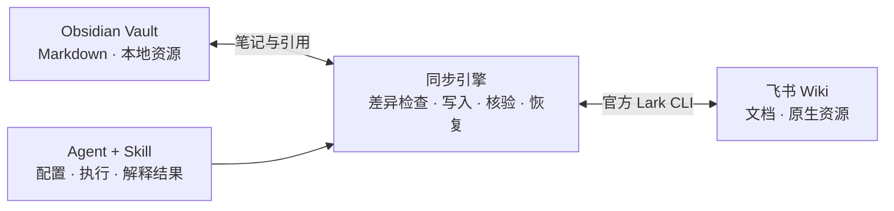

<div align="center">

<h1>Obsidian ↔ Feishu Bridge</h1>

**Obsidian 与飞书，平级编辑，持续同步。**

[简体中文](README.md) · [English](README.en.md) · [Agent Skill](skills/obsidian-feishu-sync/SKILL.md) · [验证记录](docs/validation.md)

**0.1.0 alpha** · Python 3.11+ · [MIT](LICENSE)

</div>

把 Obsidian Vault 与飞书 Wiki 子树连接成一套能从两端更新的知识库。正文、图片和内部引用按对象身份同步；PDF、飞书电子表格、多维表格和画板保留云端对象，通过本地入口访问。

同步桥补齐从文件系统到文档系统的四个环节：**接通官方接口、转换资源与链接、规划文档树路径、判断双端独立修改**。引擎维护身份映射和两端各自的基线，生成局部补丁，写入后回读正文结构，新增图片下载后按字节核验；单篇冲突单独保留，库内其他安全改动继续完成。

首次由 Skill 引导登录、选择 Vault 与 Wiki 范围；后续比较、传输和恢复交给代码。状态保存在本机档案，新 Agent 可以直接接续，**同步引擎的模型 API 调用为零**。Agent 用于配置和异常解释时产生的模型用量另计。

**70 项合成测试、8 组飞书真实接口实测（合成数据）。** 验证包含 130 段长文的有序分批写入、只修改图片文件字节后的更新、循环引用的新笔记配对，以及冲突隔离后其余独立笔记继续同步。重复运行验收项均达到零额外写入，实测环境与每轮覆盖见[验证记录](docs/validation.md)。

## 目录

- [为什么需要同步桥](#为什么需要同步桥)
- [快速开始](#快速开始)
- [自己安装与连接](#自己安装与连接)
- [平时怎样使用](#平时怎样使用)
- [哪些内容会同步](#哪些内容会同步)
- [两端都修改了怎么办](#两端都修改了怎么办)
- [持续同步](#持续同步)
- [数据、隐私与恢复](#数据隐私与恢复)
- [常见问题](#常见问题)
- [项目结构与验证](#项目结构与验证)

## 为什么需要同步桥

### 1. 官方工具之间，缺少现成的双端同步链路

[Obsidian Sync](https://help.obsidian.md/sync) 负责 Vault 在设备之间的同步，[官方 Lark CLI](https://github.com/larksuite/cli) 提供飞书文档、Wiki 和资源的访问能力。将一个 Vault 与一个 Wiki 子树持续配对，还需要跨系统的身份登记、内容比较、路径映射和冲突恢复。本项目在官方 CLI 之上实现这套同步引擎，让 Agent 可以直接完成接管与后续更新。

### 2. 附件格式和引用不同，全量搬运会放大成本

Obsidian 将图片、PDF 等资源保存为文件，通过本地路径引用；飞书使用文档块、资源 token 和云端地址，并承载电子表格、多维表格和画板。反复传输大体积 PDF 会消耗带宽和等待时间；将多维表格的记录与视图、画板中的图形节点完整读取再重建，还会增加 API 调用和转换步骤。复制附件名称和原链接无法维持两端的引用关系。

同步桥按资源类型安排传输：**图片原生嵌入并核对字节，云端 PDF 保留访问入口，飞书原生表格和画板保留原对象**。本地引用文件按同步范围与内容哈希托管，同一内容在同一范围内复用；文件修改后创建新的托管版本，已有版本保留。笔记和附件引用通过身份映射转换成本地路径或飞书地址。新笔记先分配 Wiki 节点身份，再写入正文，互相引用的笔记也能在同一轮同步中建立对应关系。

这把正文更新与大资源搬运分开：日常先批量比较已配对文档的元数据，再读取候选正文；正文使用局部补丁，未变化的资源保持已有引用，模型无需逐篇参与比对。

### 3. 文件夹与文档树表达不同，路径需要重新规划

Obsidian 以文件系统组织资料，文件夹容纳 Markdown 与附件；飞书以 Wiki 节点组织文档，父文档可以同时包含正文和子文档，正文内部还可以嵌入文件。直接照抄目录，会丢失父文档的内容位置，或把资源引用误当成普通笔记路径。

同步桥将文档层级展开为本地内容结构：带子文档的 `Topic` 映射成 `Topic/_index.md` 与同目录下的子笔记，本地新文件夹对应 Wiki 容器节点。对象身份独立于显示名称，重名和 Windows 非法字符使用稳定后缀处理，跨端引用依据已登记的对象身份转换。

### 4. 两端都可能是新修改，需要独立基线判断

首次接入时，两端可能各有一批最近修改的文档，却没有共同同步历史；配对以后，同一篇笔记又可能在两端分别修改。较新的时间戳无法说明一份内容是否包含另一端的编辑。

首次接管仅自动配对唯一且等价的内容，同路径异稿单独保留待处理。后续为 Markdown 与飞书正文分别保存已核验基线，识别本地单改、云端单改、等价双改和冲突双改：**单改同步，等价双改对齐基线，冲突双改保留两份并隔离到单篇**。写入日志、原稿快照和异常中间版本一起留存，为中断后的核验与恢复提供依据。

### 把这条链路交给 Skill 和代码

Skill 负责收集范围、引导官方 CLI 授权、执行流程与解释待处理项；代码维护对象身份、资源引用、变更状态和恢复记录。运行结果以统计和暂停项目交给 Agent，新会话从档案恢复状态，持续轮询直接由 `watch` 进程完成。



两端保留各自的使用方式：本地笔记继续使用 Vault 路径，飞书笔记通过文档身份互相引用；PDF、原生表格和画板的入口指向其云端对象。

## 快速开始

将下载后的项目目录交给 Agent，直接发送：

```text
请读取本仓库的 skills/obsidian-feishu-sync/SKILL.md，安装同步引擎和技能，
带我连接 Obsidian Vault 与飞书 Wiki。
引导我完成官方 CLI 登录，询问 Vault 目录、Wiki 范围和首次接管模式。
先展示双方已有内容的接管计划，再同步支持的改动，逐项报告暂停原因。
```

你需要提供自己的 Vault 目录和 Wiki 链接，并在浏览器中完成飞书授权。**Skill 与引擎需要一起安装**：Skill 告诉 Agent 如何执行，命令行程序 `ofb` 负责实际核对和传输；只复制 `SKILL.md` 不会获得同步程序。

已有档案后，一句话即可继续：

> 使用 obsidian-feishu-sync 技能，同步 notes 档案，报告单独暂停的项目。

## 自己安装与连接

需要 Python 3.11+。下面的官方 CLI 安装命令还需要 Node.js/npm；已有官方 CLI 时可以跳过其安装步骤。先下载并解压项目源码，在包含 `pyproject.toml` 的目录开始。

<details>
<summary>展开手动安装与首次连接步骤</summary>

创建虚拟环境：

```sh
python -m venv .venv
```

PowerShell 激活：`.venv\Scripts\Activate.ps1`；macOS/Linux 激活：`source .venv/bin/activate`。
如果当前终端不能激活，也可以用该虚拟环境中的 Python 和 `ofb` 可执行文件的完整路径执行后续命令。

激活后安装引擎与官方 CLI：

```sh
python -m pip install .
npx @larksuite/cli@latest install
ofb install-skill
```

已有 wheel 也可直接用 `python -m pip install 安装包路径.whl` 安装。
`ofb install-skill` 默认安装到 Codex 的技能目录，其他 Agent 可用 `--output` 指定目录。公开包包含程序与通用样例，使用者配置自己的 Vault 和 Wiki。

### 首次连接

新建飞书 CLI 应用并登录：

```sh
ofb auth --setup
```

若官方 CLI 应用已经配置，使用 `ofb auth` 登录即可。用户在自己的浏览器中完成授权，
同步桥不读取或保存登录密钥。CLI 不在 PATH 时，为 `auth` 和 `init` 指定 `--cli` 路径。

创建档案、检查首次接管计划，然后执行同步：

```sh
ofb --profile notes init
ofb --profile notes plan
ofb --profile notes bootstrap --approve
ofb --profile notes sync --approve
```

`init` 会询问 Vault 路径、Wiki 链接和首次模式；Vault 目录须已存在，可以为空。
也可以传入 `--vault`、`--wiki`、`--mode` 参数。`notes` 是可自定义的档案名，后续 Agent 可通过
`ofb profiles` 找到它，无需依赖旧对话。

| 首次模式 | 如何接管现有内容 |
|---|---|
| `local` | 配对唯一且等价的内容，为其余本地笔记创建云端对应项；保留无关云端内容 |
| `cloud` | 配对唯一且等价的内容，导入其余云端内容；保留无关本地内容 |
| `both` | 配对唯一且等价的内容，接管双方独立内容；同路径的不同稿件暂停 |

`plan` 不改两端笔记。`bootstrap` 将已核验计划写入本机状态，不改正文；
`sync --approve` 才执行支持范围内的写入与回读核验。存在冲突时，其余独立项目仍可继续。

选择的 Wiki 页面用作子树容器，默认不导入该根页面自身的正文。同名本身不代表同一篇笔记。
首次冲突可以暂留；明确选择保留两份后，可按[英文说明](README.en.md#first-use)使用 decisions 文件，
或后续执行 `resolve --cloud 文档标识 --keep-both --approve`。该命令处理首次接管冲突，保留其他已核验基线。

</details>

## 平时怎样使用

安装和首次接管完成后，说出这次要做的事即可：

```text
使用 obsidian-feishu-sync 技能，同步 notes 档案，报告单独暂停的项目。

检查 notes 档案的双端差异，这次只检查，不执行同步。

查看 notes 档案最近一次同步的结果，解释需要我处理的项目。
```

也可以直接调用代码：

| 你想做什么 | 命令 |
|---|---|
| 找到已有档案 | `ofb profiles` |
| 检查差异 | `ofb --profile notes check` |
| 执行同步 | `ofb --profile notes sync --approve` |
| 查看最近结果 | `ofb --profile notes status` |
| 检查配置及 Wiki 访问 | `ofb --profile notes doctor --network` |

档案在本机保存 Vault、Wiki 范围、身份映射和恢复状态。新会话可以先发现档案，再执行相同流程，无需接收完整旧对话。

## 哪些内容会同步

| 内容 | 当前行为 |
|---|---|
| 普通正文、基本列表、粗斜体、代码、公式 | 支持范围内双向转换与局部更新 |
| 普通 Markdown 表格 | 支持可核验的单元格结构；复杂合并或布局暂停 |
| 内部笔记引用 | 按身份翻译，包括互相引用的新笔记 |
| 图片 | 默认原生嵌入、字节核验；只改图片文件也能检测；云端新图片保存到 `_attachments/feishu/` |
| 云端 PDF、文件 | 本地保留访问入口，不下载 PDF 正文 |
| 本地已引用文件、PDF | 按范围和内容哈希上传、转译引用，保留此前托管版本 |
| 电子表格、多维表格、画板 | 保留云端原生对象与本地访问入口，不回写其记录、视图或画板内部内容 |
| 未知、歧义或无法无损表示的结构 | 单项暂停并保留证据 |

目录映射示例：

| Wiki 中的位置 | 本地表示 |
|---|---|
| 选定的根页面 | 同步范围的容器，根正文默认不导入 |
| `Topic` 文档，且有子文档 | `Topic/_index.md` 保存其正文 |
| `Topic` 下的 `Example` 文档 | `Topic/Example.md` |
| 原生资源节点 | 含访问入口的本地 Markdown 文件 |

当前布局为 `document_tree`，已核验配对的路径保持稳定。资源类型、托管与引用策略见[策略说明](skills/obsidian-feishu-sync/references/policies.md)。

`ofb_id` 是本地身份字段。同目录改名可据此保留身份；删除传播、歧义移动、标题锚点替换以及复杂原生布局属于人工处理边界。

## 两端都修改了怎么办

每端分别与自己的已核验基线比较。时间戳用于发现候选变化，不作为覆盖依据。

| 相对基线的变化 | 处理方式 |
|---|---|
| 只有本地改变 | 更新云端并回读核验 |
| 只有云端改变 | 更新本地并核验表示 |
| 两端已改为等价内容 | 对齐基线，无需重复写正文 |
| 两端改成不同内容 | 单篇暂停，保留两端及证据；其余独立笔记继续 |
| 两端均未变化 | 跳过正文写入 |

飞书 revision 用于乐观版本检查，检查与写入之间仍可能插入其他编辑。引擎通过前置核验、结构回读和异常版本留存识别这类变化，并在无法确认结果时保留状态，供后续核验与恢复。

## 持续同步

希望机器开着时由程序持续同步，可以运行：

```sh
ofb --profile notes watch --approve --interval 120
```

程序每两分钟轮询，无变化时保持安静；网络故障退避，授权故障停止并等待处理。它需要机器运行，不会自行安装开机任务，也无需反复唤醒 Agent。

## 数据、隐私与恢复

默认运行数据位于用户应用数据目录；可用 `--data-home` 或 `OFB_DATA_HOME` 指定其他私有位置。
配置包含本人的 Vault 路径和 Wiki 范围，数据库与恢复记录可能包含正文、资源标识和历史内容，
应与公开源码分开放置。官方 CLI 独立保存认证，同步桥不搬运其凭证。

同步时，支持的内容会在所选 Vault 与飞书范围间传输；引擎没有模型调用、开发者接收端或分析上报代码。
Skill 引导 Agent 优先读取统计、暂停原因及必要证据，而非把整库正文装入对话。
报告、日志、冲突快照和登录回执仍属于使用者的私有运行数据，不能直接作为公开示例。

首次接管扫描现有内容建立基线；后续按元数据和基线选择需要读取的文档。默认每小时发现新节点、每天扫一次正文，
可用 `--discover`、`--full` 强制检查。API 访问频率和传输量由这些策略及实际变更决定。

退出码 `0` 表示支持范围内的流程完成；`4` 表示存在单项暂停；`2` 表示环境或流程错误。
写入后也可能发生报错，应沿用原档案恢复并查看记录，不能删除 SQLite 来强迫“重新同步”。

## 常见问题

**配置后怎样持续运行？** 首次授权并选定范围后，`watch` 按设定间隔核对并处理支持的变更。单篇冲突隔离到相关项目，其余安全改动继续完成；授权中断会停止轮询并保留状态。

**为什么只装 Skill 还不够？** Skill 是 Agent 的操作指引，`ofb` 是执行程序。将两者一起安装，Agent 才能直接核对和同步。

**以后怎样更新？** 下载或拉取新版源码，在原环境运行 `python -m pip install --upgrade .`，再用 `ofb install-skill --replace` 更新技能。查看发布说明并保留原档案和 SQLite，不重新初始化已有同步关系。

**出错后从哪里看？** `status` 查看最近结果，`doctor --network` 检查环境。写入后也可能发生报错，应沿用原档案和恢复记录继续检查。

## 项目结构与验证

```text
obsidian-feishu-bridge/
├── skills/obsidian-feishu-sync/   # Agent 的操作入口及参考资料
├── src/obsidian_feishu_bridge/    # 同步引擎与 CLI
├── tests/                        # 合成测试及显式开启的在线验收
├── examples/                     # 只含占位符的配置样例
└── docs/                         # 架构、验证记录与版本说明
```

当前已完成 **70 项合成测试**与 **8 组飞书真实接口实测（合成数据）**，实测环境为 Windows、Python 3.14.8、官方 Lark CLI 1.0.97。实测在独立测试 Vault 和飞书隔离子树中运行，使用生成的笔记、图片和 PDF。场景覆盖与各轮记录见[验证记录](docs/validation.md)。GitHub CI 覆盖 Windows、Linux、macOS 与 Python 3.11、3.14 的组合，每次分支提交和 PR 都运行检查，[构建结果](https://github.com/ZhanyuGuo314/obsidian-feishu-bridge/actions/workflows/ci.yml)按具体提交记录。

[架构说明](docs/architecture.md) · [配置样例](examples/profile.example.json) · [版本说明](docs/release-0.1.0.md) · [贡献与验证](CONTRIBUTING.md) · [安全说明](SECURITY.md) · [MIT 许可证](LICENSE)
